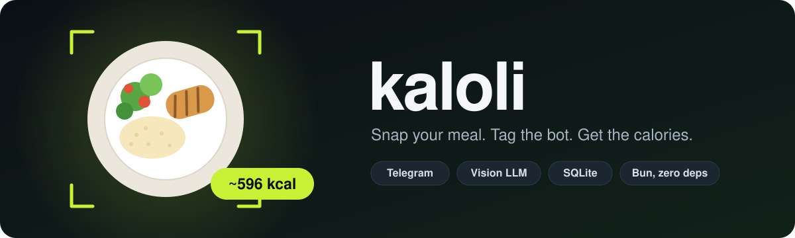
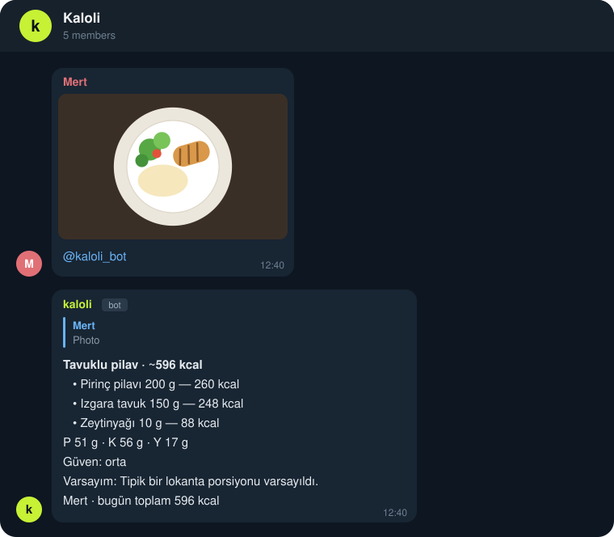
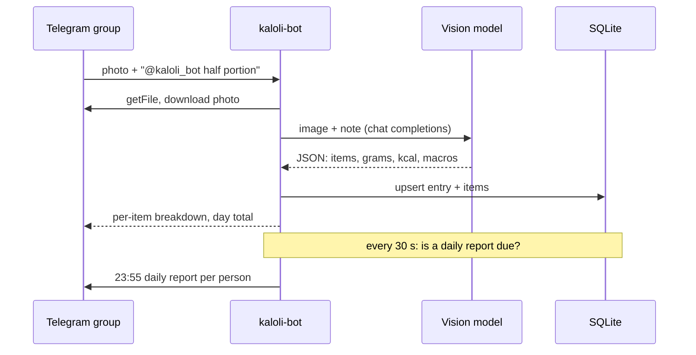

<p align="center">
  
</p>

<p align="center">
  
  
  
  
  
</p>

# kaloli-bot

A Telegram group bot for friends who want to keep each other honest about food.
Post a photo of your meal, tag the bot, and it replies with a per-item calorie estimate.
Every estimate is stored, and at the end of the day the group gets a per-person breakdown.

The bot's messages are in Turkish.

<p align="center">
  
</p>
<p align="center"><sub>Illustration. The reply text is the bot's real output format, rendered for sample data.</sub></p>

## What it does

- **Photo in, calories out.** Tag the bot in a photo caption; a vision model estimates each item's grams, calories and macros.
- **Your note counts.** Anything else in the caption goes to the model: "half portion", "there were 5 eggs, I ate 2". The reply states what was assumed.
- **Forgot the tag?** Reply to the photo and tag the bot. Tagging the same photo again with a new note replaces the estimate instead of counting it twice.
- **Daily report.** At 23:55 the group gets everyone's total and every meal with its time, note and items. A report missed while the machine was off is sent when it comes back.
- **Leaderboard.** `/siralama` ranks the group by calories for the week, the day, the month or all time.
- **Yours to run.** One process, one SQLite file, no webhook and no open port. The bot only works in chats you allowlist.

## How it works



The bot long-polls Telegram, so it runs behind NAT with nothing exposed.
The vision model is reached through any OpenAI-compatible `/v1/chat/completions` endpoint that accepts images; the default points at a local proxy on `127.0.0.1:8317`.

## Example output

Daily report:

```text
Günlük rapor · 19 Kasım Perşembe

Deniz — 355 kcal (2 kayıt)
P 23 g · K 34 g · Y 14 g
08:30 · Haşlanmış yumurta — 170 kcal
  Not: 5 yumurta vardı, 2 tanesini yedim
  • Haşlanmış yumurta, 2 adet · 100 g — 155 kcal
  • Yeşillik 40 g — 15 kcal
19:10 · Mercimek çorbası — 185 kcal
  Not: yarım porsiyon
  • Mercimek çorbası 150 g — 105 kcal
  • Ekmek, 1 adet · 30 g — 80 kcal

Mert — 596 kcal (1 kayıt)
P 51 g · K 56 g · Y 17 g
12:40 · Tavuklu pilav — 596 kcal
  • Pirinç pilavı 200 g — 260 kcal
  • Izgara tavuk 150 g — 248 kcal
  • Zeytinyağı 10 g — 88 kcal

Değerler fotoğraftan tahmindir; gerçek kaloriden belirgin sapabilir.
```

Leaderboard (`/siralama`):

```text
Sıralama · bu hafta (16 Kasım – 19 Kasım)

1. Mert — 596 kcal
    1 kayıt

2. Deniz — 355 kcal
    2 kayıt

Toplam kaloriye göre, çoktan aza. Yalnızca fotoğrafı atılan öğünler sayılır.
```

## Quick start

You need [Bun](https://bun.sh), a bot token from [@BotFather](https://t.me/BotFather), and an OpenAI-compatible vision endpoint with its API key.

```bash
git clone https://github.com/cengizhankose/kaloli-bot.git
cd kaloli-bot
bun install                # dev types only; the bot itself has no dependencies
cp .env.example .env       # fill in TELEGRAM_BOT_TOKEN and PROXY_API_KEY
bun run start
```

Then, in Telegram:

1. In BotFather run `/setprivacy`, pick the bot, choose **Disable**. Do this before adding the bot to the group.
2. Add the bot to your group and send `/chatid`.
3. Put the number it answers with into `ALLOWED_CHAT_IDS` in `.env` and restart the bot.
4. Post a meal photo with `@your_bot` in the caption.

To keep it running on macOS (starts at login, restarts if it exits):

```bash
bin/service install
bin/service status      # also: logs, restart, uninstall
```

Full setup and day-to-day operation: [docs/operations.md](docs/operations.md).

## Commands

| In the group | What happens |
|---|---|
| Photo with `@bot` in the caption | Estimate, store, reply. The rest of the caption is the note. |
| Reply to a photo with `@bot` | Same, for a photo posted without the tag. Re-tagging replaces the estimate. |
| `/rapor` | Today's breakdown so far. |
| `/siralama` | This week's ranking. Also `/siralama bugun`, `/siralama ay`, `/siralama hepsi`. |
| `/sil` (as a reply to the photo or to the bot's answer) | Deletes your own entry. |
| `/chatid` | Prints the chat id, for the allowlist. Works in any chat. |
| `/help` | Usage summary. |

## Configuration

Everything is read from `.env`.

| Variable | Default | Meaning |
|---|---|---|
| `TELEGRAM_BOT_TOKEN` | required | Token from BotFather. |
| `PROXY_API_KEY` | required | API key for the vision endpoint. |
| `ALLOWED_CHAT_IDS` | empty | Comma-separated chat ids the bot works in. Empty means it analyses nothing. |
| `PROXY_BASE_URL` | `http://127.0.0.1:8317` | Base URL of the OpenAI-compatible endpoint. |
| `VISION_MODEL` | `gemini-3.5-flash-lite` | Any image-capable model the endpoint serves. |
| `TIMEZONE` | `Europe/Istanbul` | Decides which day a meal belongs to and when the report goes out. |
| `REPORT_TIME` | `23:55` | Local time of the daily report. |
| `TRIGGER_MODE` | `mention` | `all` analyses every photo in an allowed chat, tagged or not. |
| `DB_PATH` | `data/kalori.db` | SQLite file. |

## Project layout

```text
src/
  index.ts      entry point: long-poll loop, report timer
  bot.ts        message handling, commands, due-report logic
  vision.ts     prompt, model call with retries, reply parsing
  telegram.ts   minimal Bot API client
  db.ts         SQLite schema and queries
  format.ts     replies, daily report, leaderboard
  config.ts     .env parsing and validation
  dates.ts      time-zone and calendar helpers
test/bot.test.ts
bin/service     macOS LaunchAgent install/uninstall/status/logs
docs/           architecture, operations, decisions
```

```bash
bun test            # behaviour tests with a fake Telegram and a fake model
bun run type-check
```

## Documentation

- [Architecture](docs/architecture.md): modules, data model, the rules the code keeps.
- [Operations](docs/operations.md): setup, running as a service, backups, troubleshooting.
- [Decisions](docs/decisions.md): why it is built this way, and what it does not do.

## Accuracy and privacy

- Calories estimated from a photo are rough. The bot says so in every daily report, and each reply shows the model's confidence and assumption.
- The leaderboard only counts meals that were photographed. Someone who posts fewer photos looks like they ate less.
- With privacy mode disabled Telegram delivers every group message to the bot. It ignores everything except commands and photos that tag it; only those photos are sent to the model.
- Stored per entry: sender's Telegram id and display name, time, caption note, Telegram file id, the estimate, and the model's raw reply. Photos themselves are not stored. The database stays on the machine running the bot.
